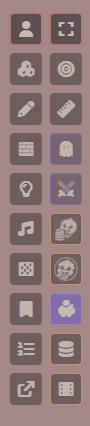
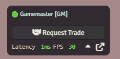
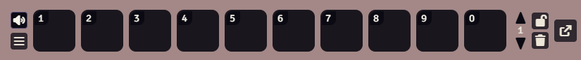
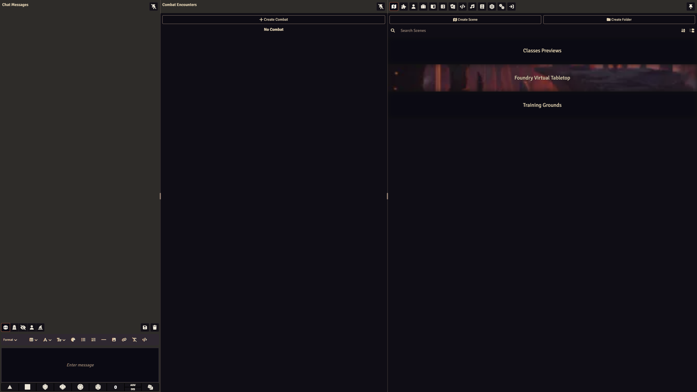
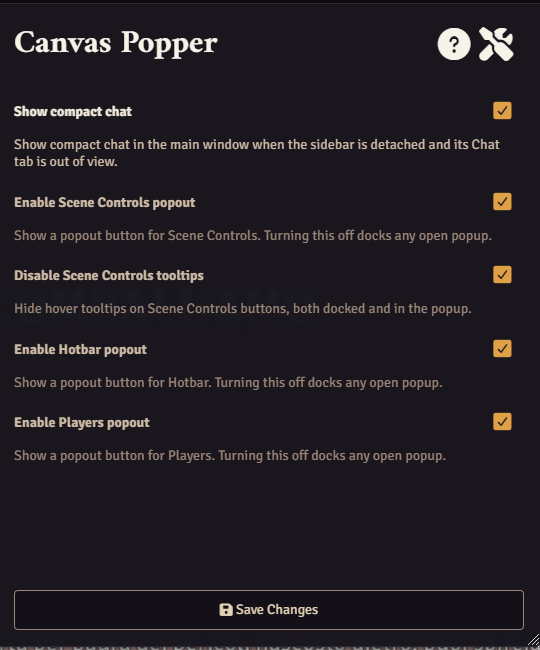

# Canvas Popper

Canvas Popper is a system-agnostic module for Foundry Virtual Tabletop v14. It lets you move the sidebar, Scene Controls, Hotbar, and Players widget into separate windows so you can arrange them around the canvas or across monitors. Each window uses the live Foundry interface from the same game session.

<!-- Add an overview screenshot of several popouts here. -->

## Installation

### From a GitHub release

In Foundry Setup, open **Add-on Modules**, click **Install Module**, and paste this URL into **Manifest URL**. It becomes available after the first release is published.

```text
https://github.com/CrazyPascu/Canvas-Popper/releases/latest/download/module.json
```

Enable **Canvas Popper** in **Manage Modules** in your world.

### Manual installation

1. Place the module files in `Data/modules/canvas-popper` inside your Foundry user data folder. The manifest should be at `Data/modules/canvas-popper/module.json`.
2. Launch your world in Foundry VTT v14 and enable **Canvas Popper** in **Manage Modules**.

## Opening and docking windows

Click the popout icon on the widget you want to move. Close its popup or click its return icon to dock it in Foundry again. The windows can be opened independently.

| Widget | Popout button location | What you can do in the popup |
| --- | --- | --- |
| Sidebar | In the sidebar tab strip | Browse tabs, pin tabs side by side, and drag documents between windows. |
| Scene Controls | At the bottom of the layer buttons | Switch canvas layers, choose tools, and open palettes. The controls stay vertical and act on the main canvas. |
| Hotbar | At the end of the hotbar | Run macros by clicking or using their number shortcuts, switch pages, and drag macros onto or between slots. The lock, mute, and slot context menus are also available. |
| Players | Next to the latency and FPS indicators | View live player status, expand the inactive player list, and use player context menus. The widget sits at the bottom left when docked. |

### Popout buttons

| Sidebar | Scene Controls | Players | Hotbar |
| --- | --- | --- | --- |
|  |  |  |  |

## Detached sidebar

The detached sidebar puts the tabs your user can access across the top. Selecting a tab opens its content below. When the window gets narrower, use the mouse wheel over the tab row to scroll sideways. The pin button stays at the right edge.

### Pinning tabs

1. Select a tab and click **Pin selected tab** at the right end of the header.
2. The pinned tab opens on the left and its icon leaves the browsing header. Each additional pin appears between the existing pins and the browsing pane.
3. Drag a pinned header left or right to rearrange the pinned columns. The whole column moves with the header, and neighboring columns snap into place as you drag.
4. Drag a divider to resize the neighboring columns. You can also focus the divider and use the left and right arrow keys. Scroll horizontally when the columns extend beyond the window.
5. Click **Unpin** in a pinned column’s header to restore that tab’s icon. Pins and column widths last for the current popup session.



### Creating documents

The **Creation dialog placement** setting controls where sidebar creation dialogs open. **Window-constrained popups** opens them inside the detached sidebar. **Normal popups** opens them in the main Foundry window. This applies to creation actions such as Create Actor, Create Item, Create Folder, and Create Compendium. Document sheets opened after creation appear in the main window.

### D&D 5e roll configuration

Enable **D&D 5e roll dialogs in sidebar** to open roll prompts in the detached sidebar when you roll from there, such as during individual initiative rolls or requests in Chat. The setting is available in D&D 5e worlds.

### Dragging documents between windows

Foundry’s permissions and the destination’s normal drop rules still apply.

| Drag from the detached sidebar | Drop onto | Result |
| --- | --- | --- |
| Actor | Main canvas | Creates an actor token on the viewed scene. |
| Item | Compatible actor sheet | Adds the item to the actor. |
| Journal entry | Main canvas | Opens Foundry’s map-note placement. |
| Existing map note from **Placeables → Notes** | Main canvas | Copies the note within the viewed scene. Hold **Shift** to bypass snapping. |
| Macro | Docked or detached Hotbar slot | Assigns the macro to the slot. |

<!-- Add a drag-and-drop screenshot here. -->

### Chat and Dice Tray

The live chat composer and controls attached to it, including Dice Tray, follow Chat into the detached sidebar. If you enable **Show compact chat**, the composer moves to the compact panel in the main window when Chat is neither selected nor pinned. Selecting or pinning Chat brings the composer back to the detached sidebar.

## Settings

Open **Settings → Configure Settings → Canvas Popper**. Each setting is saved per user and takes effect when you save it. Previously saved Sidebar Window preferences carry over when you load the world.

| Setting | Default | What it does |
| --- | --- | --- |
| **Creation dialog placement** | Window-constrained popups | Chooses where creation dialogs launched from the detached sidebar open. |
| **D&D 5e roll dialogs in sidebar** | Off | Opens roll configuration from the detached sidebar in D&D 5e worlds. |
| **Show compact chat** | Off | Shows compact chat in the main window while the sidebar is detached and Chat is neither selected nor pinned. |
| **Enable Scene Controls popout** | On | Adds the Scene Controls popout button. |
| **Disable Scene Controls tooltips** | Off | Hides hover tooltips and tool previews for Scene Controls buttons, both docked and detached. |
| **Enable Hotbar popout** | On | Adds the Hotbar popout button. |
| **Enable Players popout** | On | Adds the Players popout button. |

Turning off a popout setting docks its widget if the window is open and removes the popout button.

